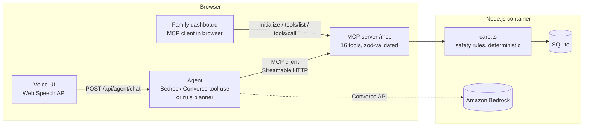

# CareCircle

**A voice-first care companion for older adults who live alone, and the family who worry about them.**
Built for the *Build, Ship, Shape: Amazon Developer Hackathon 2026*, Alexa+ track (self-hosted MCP server + simulated Alexa+-style experience).

> "Did I take my BP pill?" is one of the most common questions an older person asks, and one of the most dangerous to get wrong.

## The problem

- Older adults on several medicines regularly **miss doses or take a dose twice** because they can't remember whether they already did. Double-dosing blood-pressure or diabetes medicine can cause falls and hospital visits.
- Medicines **run out** before anyone notices.
- **Phone scams** (fake bank or KYC calls, "digital arrest", requests for OTP codes or AnyDesk) target older people first.
- Family members living in another city only find out **after** something has gone wrong.

Apps don't fix this, because many older people won't use a phone app. They will talk.

## What CareCircle does

The older person talks to an Alexa+-style assistant. The family see a live dashboard. Everything in between runs through **real MCP tools** that read and change persistent state.

| Asha says… | CareCircle does (real MCP tool calls) |
|---|---|
| "Did I take my BP pill?" | `check_dose_status`: reads the dose log and says whether another dose is safe now |
| "I just took my blood pressure pill" | `record_dose`: records it, decrements stock, warns when supply is low |
| "I took my BP pill" (again) | `record_dose` **refuses** with `DOUBLE_DOSE_RISK`, tells her not to take it, alerts the family |
| "Am I running low on anything?" | `forecast_refills` → `request_refill` **proposes** a refill → asks "Shall I go ahead?" → `confirm_action` only after "yes" |
| "When is my doctor appointment?" | `list_appointments`: notices **no ride is arranged** and offers to message the family (`notify_family`) |
| "A man from the bank wants my OTP and says install AnyDesk" | `assess_scam_risk`: flags it as a likely scam, tells her what not to do, alerts the family |
| "I feel dizzy and have chest pain" | `log_wellbeing`: red-flag triage, **urgent** family alert, "call 112 now". It never diagnoses |
| Ravi (son): "How is mom doing today?" | `get_family_digest`: adherence, missed doses, alerts, refills, appointments |

The family dashboard (same page, right-hand side or the *Family* tab on a phone) shows today's medicine timeline, alerts with a "Handled" button, actions waiting for approval, refills, appointments and how she's feeling. It reads and writes **through the same MCP server, directly from the browser**.

### Design principles

1. **Facts come from tools, never from the model.** Every safety rule (dose gaps, red-flag triage, scam scoring, confirmation) is deterministic code in [`server/src/care.ts`](server/src/care.ts). The model only chooses which tool to call.
2. **Propose, then confirm.** Refills, new appointments and cancellations return a `confirmation_id`. Nothing happens until `confirm_action`, which is idempotent (a second "yes" can't send a second refill).
3. **Honest failure.** Tool errors have a consistent shape `{code, message, retryable, details}`. The UI shows failed calls in red. If Bedrock fails, the agent says so and falls back to the rule-based planner; it never fakes an answer.
4. **Escalate, don't diagnose.** Red-flag symptoms always alert the family and point to emergency services.
5. **Transparent.** A live **MCP trace** tab shows every JSON-RPC message with its latency and payload, and the server keeps an audit log (long free text is truncated).

## Alexa+ track: what is real and what is simulated

| | Status |
|---|---|
| MCP server | **Real.** `@modelcontextprotocol/sdk` 1.32.1, protocol **2025-11-25**, **Streamable HTTP** at `POST /mcp` (stateless JSON responses) |
| MCP clients | **Real.** (1) The agent connects as an MCP client and sends `initialize`, `tools/list` and `tools/call` over Streamable HTTP. (2) The family dashboard is an MCP client running in the browser. |
| Tools and state | **Real.** 16 validated tools backed by SQLite. Changes persist across reloads. |
| Agent | Amazon Bedrock Converse API with tool use (`BEDROCK_MODEL_ID`, default Amazon Nova Pro), or a transparent rule-based planner when no AWS credentials are configured |
| Voice | Browser Web Speech API (speech recognition and synthesis; Chrome or Edge) |
| Alexa / Echo | **Simulated.** This is an independent Alexa+-*style* web experience. It is **not** connected to Alexa, an Echo device or the gated Alexa+ developer tools, which the hackathon FAQ says are not available to participants. |
| People, medicines, pharmacy | **Sample data only** (fictional people). The "pharmacy" refill and family "delivery" go to the dashboard; no SMS, no orders, no payments. |

## Architecture



The agent streams every step (MCP handshake, each tool call and result, model steps) to the browser as NDJSON, so the trace you see is the real one.

### MCP tools

`get_care_overview`, `list_medications`, `check_dose_status`, `record_dose`, `forecast_refills`, `request_refill`*, `list_appointments`, `schedule_appointment`*, `cancel_appointment`*, `confirm_action`, `log_wellbeing`, `assess_scam_risk`, `notify_family`, `list_alerts`, `acknowledge_alert`, `get_family_digest`

\* Proposal only; it needs `confirm_action`. Read-only tools carry `readOnlyHint`, and `cancel_appointment` carries `destructiveHint`.

## Run it locally

Requires **Node.js 22.13+** (uses the built-in `node:sqlite`; developed on Node 24).

```bash
cd web && npm install && npm run build && cd ..
cd server && npm install && npm start
```

Open http://localhost:8787. Use **Reset demo (10:00)** to start a reproducible demo morning (one dose due, low Amlodipine stock, cardiology appointment tomorrow with no ride arranged).

Front-end development with hot reload: run `npm start` in `server/`, then `npm run dev` in `web/` (Vite proxies `/mcp` and `/api`).

### Use Amazon Bedrock

1. In the AWS console, enable model access for the model you want (default `us.amazon.nova-pro-v1:0`, region `us-east-1`).
2. Make credentials available the standard way (`aws configure`, `AWS_PROFILE`, or an IAM role when deployed). Never commit keys.
3. Optionally copy `.env.example` to `.env` and set `AGENT_MODE=bedrock` or `BEDROCK_MODEL_ID`.

The header badge shows which agent is active. If a Bedrock call fails, the trace shows a warning and the reply comes from the rule planner instead.

### Connect any MCP client

```bash
curl -s -X POST http://localhost:8787/mcp \
  -H 'Content-Type: application/json' -H 'Accept: application/json, text/event-stream' \
  -d '{"jsonrpc":"2.0","id":1,"method":"initialize","params":{"protocolVersion":"2025-11-25","capabilities":{},"clientInfo":{"name":"curl","version":"1"}}}'
```

## Tests and evaluation

```bash
cd server
npm test        # 11 domain tests + 6 protocol tests (raw JSON-RPC and SDK client against a live server)
npm run eval    # 30 end-to-end conversations through agent -> MCP -> SQLite (server must be running)
```

`npm run eval` resets the demo to 10:00 before each case and writes [`docs/evaluation-rules.md`](docs/evaluation-rules.md) or `docs/evaluation-bedrock.md`, depending on the active agent. Categories: basic requests, double-dose safety, confirmation gate, symptoms, scams, ambiguity and robustness.

Note: the rule-based planner was developed against these same 30 cases, so its score shows the plumbing and safety rules work, not that it understands language in general. The Bedrock run is the meaningful language-understanding result.

## Privacy and safety

- All people and data are fictional sample data. There is no real calendar, pharmacy, SMS or health record.
- CareCircle is **not a medical device** and gives no medical advice. In an emergency, call 112 (India) or 911 (US).
- The audit log truncates long free text. Secrets are read from the environment only.

## Known limitations and next steps

- Notifications go to the in-app family dashboard only. Real SMS or push (for example Amazon SNS) is the next step.
- Single household, no authentication. A real deployment needs accounts and per-caregiver permissions.
- SQLite on a container's local disk resets when the container is redeployed. Use a managed database for anything beyond a demo.
- The scam and symptom checks are transparent keyword rules, chosen so they can be explained and audited. A model-based classifier could add recall, with the rules kept as a floor.
- Real Alexa+ integration needs the gated Alexa+ Add-on tools. The MCP server is ready to be registered once that access exists.

## License

MIT (see [LICENSE](LICENSE)).
