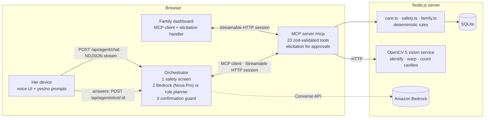

# CaringU

**Ask before you act.** CaringU is a voice-first companion that sits between an older adult and a risky moment (an extra pill, a scam call, a QR code that "pays you a refund", a fall) and brings the family (her *care circle*) in, fast.

One product, entered in four contests (see [docs/WIN-PLAN.md](docs/WIN-PLAN.md)): the *Amazon Developer Hackathon* (Alexa+ track), the *OpenCV AI Competition 2026*, the *Nebius x NVIDIA Global AI Hackathon* and the *PayPal AI Hackathon*. At its core is a self-hosted **MCP server** (spec 2025-11-25, Streamable HTTP) plus an Alexa+-style experience whose web clients are real MCP clients.

## The problem

- Older adults on several medicines often can't remember whether they already took a dose, so they **miss doses or take one twice**.
- **Phone scams** target them first: fake bank or KYC calls, "digital arrest", "your grandson is in jail", requests for OTP codes or AnyDesk.
- **Falls and stroke signs** need someone to act within minutes, but family members often live in another city and find out late.
- Many older people won't use an app. They will talk.

## The experience

| Asha says… | What happens (real MCP tool calls) |
|---|---|
| "A man from the bank is still on the line asking for my OTP" | The safety screen flags a likely scam, and `assess_scam_risk` records it. She hears **"Hang up now"** and why. **Ravi** gets an urgent alert. If he doesn't respond in 3 minutes, it **escalates to Neha**; if nobody responds, her device tells her to call 112. |
| *(Ravi taps "I'm calling her now" or a quick reply)* | `respond_to_alert` stops the escalation, and her device **reads Ravi's message aloud** (`get_announcements`). |
| "I took my BP pill" (already recorded at 9:05) | `record_dose` changes nothing and asks: *"Is that the dose you mean, or did you take another one just now?"* If it was **another**: the dose is recorded as extra, the family gets an **urgent** alert, and she is told to call her pharmacist (or 112 if she feels faint). |
| "Should I take my blood pressure tablet?" | `check_dose_status` reports **what is recorded**. It never says a dose is "safe", and it suggests checking her pill organiser or asking the pharmacist. |
| "My face feels strange and my words are coming out wrong" | Stroke signs are caught deterministically: `log_wellbeing` sends an urgent alert, and the reply starts with **"Please call 112 now."** |
| "I'm running low on my BP pills" | `request_refill`: the **MCP server asks her directly** ("Send a refill request for 30 × Amlodipine…?"), by voice or with Yes/No buttons. The refill runs only if she says yes. |
| Ravi: "Any problems with mom today?" | `get_family_digest`: doses taken and missed, alerts, refills, appointments, and whether a ride is arranged. |

### Scam Lens: the camera answers "is this code safe?"

Scammers now send QR codes that supposedly *give* money ("scan to receive your ₹5,000 cashback"). Scanning a payment code always *sends* money.
1. Asha shows the camera the code ("Check a QR code or payment request", or one of the three samples in the demo).
2. **OpenCV 5** ([`lens.py`](vision/carecircle_vision/lens.py)) finds and decodes it: `QRCodeDetector` and `QRCodeDetectorAruco` over a short ladder of views (raw, CLAHE-equalised, upscaled, unsharp-masked, adaptive-threshold), stopping at the first view that decodes. It also measures blur and brightness, so an unreadable photo gets "hold it closer and steadier", never a guess.
3. **Fixed rules** ([`lens.ts`](server/src/lens.ts)) decide what the code means. A UPI or PayPal payment code presented as a prize, refund or KYC is a scam; look-alike bank links, app downloads and crypto requests are scams; shortened, insecure or odd-domain links are suspicious.
4. The verdict decides what happens next. A scam raises an **urgent family alert** and **blocks the payee**; a suspicious link warns the family; a normal bill only reminds her that paying sends money. No language model is involved in the verdict.

On 640 generated photos with controlled distance, blur, tilt, lighting and JPEG damage, the plain OpenCV call read **89.7%** of codes and the ladder read **99.5%**, with **no wrong reads**, at a median 44 ms per photo. Generated photos measure robustness, not real-world accuracy; real phone photos are reported separately. Full results: [docs/lens-eval.md](docs/lens-eval.md).

### Strip check: the camera answers "did I take it?"

CaringU's records only know doses someone reported. The **strip check** adds evidence:
1. Asha holds a medicine **blister strip** up to the camera ("📷 Show a medicine strip").
2. An **OpenCV 5** service identifies which registered medicine it is, or **refuses if unsure**. It never guesses.
3. It counts full and empty cavities and returns an annotated photo.
4. CaringU **reconciles the count with the dose log** since the previous check:

| What the strip shows | What happens |
|---|---|
| Same number gone as doses recorded | "That matches what I have recorded." |
| **One more gone** than recorded | The MCP server asks her (elicitation): *"Record it as taken now?"* It records the dose only on yes. |
| **Two or more more gone**, or one more while a dose is already recorded within the minimum gap | **Possible double dose:** an urgent family alert, decided by deterministic rules, and she's told to call her pharmacist (or 112 if unwell). |
| Fewer gone than recorded | Noted (perhaps another strip was used). |

Caregivers register each medicine once from the dashboard with a top-down reference photo. Details: [`vision/`](vision) and [docs/vision-eval.md](docs/vision-eval.md).

**OpenCV 5 pipeline** ([`strip.py`](vision/carecircle_vision/strip.py)):

| Step | OpenCV operations |
|---|---|
| Identify the strip | CLAHE, then SIFT, then FLANN kNN with Lowe's ratio test, then `findHomography` (USAC_MAGSAC). Geometry is checked for convexity and area, and close calls go to printed-foil normalised cross-correlation. |
| Straighten it | `warpPerspective` into the reference's canonical frame |
| Find cavities (at registration) | Canny, morphology and `minAreaRect` for the outline, then `HoughCircles`, clustered with `kmeans` into an evenly spaced rows × cols grid |
| Full or empty | Per-cavity CIE Lab distance to the learned pill colour and to the *local* foil ring (handles uneven light), plus a Laplacian texture cue for torn foil |

The family dashboard (right side, or the *Family* tab on a phone) is a second MCP client running in the browser. It shows live alerts with the escalation chain and timeline, response buttons, today's medicine timeline, approvals, refills, appointments and messages sent to her device.

## What makes it trustworthy

1. **Safety does not depend on the AI.** Every message first passes a deterministic **safety screen** ([`safety.ts`](server/src/safety.ts), [`screen.ts`](server/src/screen.ts)):
   - Symptom triage handles negation and third-party mentions ("I don't have chest pain", "my friend fell"). Its rules follow public first-aid red flags: FAST stroke signs, chest pain, breathing trouble, collapse, falls with injury, low-sugar confusion.
   - The scam screen follows the common scam playbook (credential requests, gift cards or crypto, remote-access apps, authority plus threat, family emergency plus money, secrecy). It also recognises legitimate notices, such as a bank telling you to call the number on your card, so they don't trigger alarms.
   - When the screen fires, the MCP tool runs and the emergency or scam instruction is guaranteed to be in the reply, whatever the agent does.
2. **Approvals are enforced by the protocol, not the prompt.** Refills and appointment changes use **MCP elicitation**: the server sends `elicitation/create` on the SSE stream of the in-flight `tools/call`, and the person answers on their device or dashboard. The language model never sees or produces the approval. Clients without elicitation fall back to a two-step `confirmation_id` → `confirm_action` flow, behind a deterministic guard that blocks the model from approving anything unless the user's latest message says yes.
3. **Honest about uncertainty.** Medication answers say what is *recorded*, never that a dose is *safe*. Missed doses go to the pharmacist. Tool errors are structured (`code`, `message`, `retryable`) and shown in red in the trace. If Bedrock fails, the trace says so and the rule-based planner answers instead.
4. **Family in the loop, with a deadline.** Urgent alerts follow an escalation ladder (Ravi → Neha → tell her to call 112), driven by a reproducible clock and fully tested.
5. **Transparent.** The **MCP trace** tab shows every JSON-RPC step: initialize, tools/list, each tools/call with its latency, the safety screen verdict, elicitation questions and answers, and guard blocks. The server keeps an audit log (long free text is truncated).

## Alexa+ track: what is real and what is simulated

| | Status |
|---|---|
| MCP server | **Real.** `@modelcontextprotocol/sdk` 1.32.1, protocol **2025-11-25**, **Streamable HTTP** at `/mcp`. Session-based (`Mcp-Session-Id`, GET/DELETE per spec), with SSE responses so the server can send elicitation requests mid-call. 24 tools. |
| Vision | **Real.** OpenCV 5.0.0 service (Python, FastAPI), called by the MCP server. Unit and end-to-end tests use synthetic strips; real-photo accuracy is in [docs/vision-eval.md](docs/vision-eval.md). |
| MCP clients | **Real.** (1) The agent (server side) runs `initialize`, `tools/list` and `tools/call`, and handles elicitation by relaying questions to the device. (2) The family dashboard is an MCP client in the browser with its own elicitation handler. |
| State | **Real.** SQLite (Node's built-in `node:sqlite`). Changes persist and are verified by re-reading. |
| Agent | **Amazon Bedrock** Converse API with tool use (default `amazon.nova-pro-v1:0`), or a transparent rule-based planner when no AWS credentials are configured |
| Voice | Browser Web Speech API (speech recognition and synthesis, Chrome or Edge) |
| Alexa / Echo | **Simulated.** An independent Alexa+-*style* web experience. **Not** connected to Alexa, an Echo device or the gated Alexa+ developer tools, which the FAQ says are not available to participants. |
| People, pharmacy, notifications | **Sample data** (fictional people). Refills go to a simulated pharmacy. Family alerts and replies travel through the CaringU dashboard and device; there is no SMS. No orders and no payments. |

## Architecture



### MCP tools (24)

| Area | Tools |
|---|---|
| Medicines | `get_care_overview`, `list_medications`, `check_dose_status`, `record_dose`, `forecast_refills`, `request_refill`† |
| Appointments | `list_appointments`, `schedule_appointment`†, `cancel_appointment`† |
| Approvals | `confirm_action` (fallback for clients without elicitation) |
| Safety | `log_wellbeing`, `assess_scam_risk` |
| Camera | `check_code_with_camera` (Scam Lens), `inspect_medicine_strip`‡, `register_medicine_strip`, `list_strip_checks` |
| Family loop | `notify_family`, `list_alerts`, `acknowledge_alert`, `respond_to_alert`, `send_message_to_elder`, `get_announcements`, `mark_announcements_heard`, `get_family_digest` |

† Approved by a human through MCP elicitation, or through `confirm_action` for clients that can't elicit.
‡ Records an unlogged dose only after the person confirms it through elicitation.

## Run it locally

Requires **Node.js 22.13+** (built-in `node:sqlite`; developed on Node 24).

```bash
cd web && npm install && npm run build && cd ..
cd server && npm install && npm start
```

Camera checks (Scam Lens and strip check; optional, needs Python 3.11+), in a second terminal:

```bash
cd vision && python -m venv .venv && .venv/Scripts/pip install -r requirements.txt   # macOS/Linux: .venv/bin/pip
cd ../server && npm run vision     # OpenCV service on :8790
```

Open http://localhost:8787.
Open **Try it**. Under **Demo controls**:
- **Restart the day at 10:00** starts a reproducible morning: one dose due, low Amlodipine stock, and a cardiology appointment tomorrow with no ride arranged.
- **+3 minutes** moves the demo clock forward so you can watch an alert escalate; **+1 hour** passes the 11:00 check-in.

### Use Amazon Bedrock

1. Use a least-privilege identity, not the root account. The policy only needs `bedrock:InvokeModel` on `arn:aws:bedrock:us-east-1::foundation-model/amazon.nova-pro-v1:0`.
2. Configure that identity as a profile, for example `aws configure --profile carecircle-dev`.
3. Copy `.env.example` to `.env` and set `AWS_PROFILE=carecircle-dev` and `AGENT_MODE=bedrock`.

**How it's built** shows which agent is answering right now.

### Connect any MCP client

```bash
curl -si -X POST http://localhost:8787/mcp \
  -H 'Content-Type: application/json' -H 'Accept: application/json, text/event-stream' \
  -d '{"jsonrpc":"2.0","id":1,"method":"initialize","params":{"protocolVersion":"2025-11-25","capabilities":{},"clientInfo":{"name":"curl","version":"1"}}}'
```

Use the returned `Mcp-Session-Id` header on later requests. Declare `"capabilities":{"elicitation":{"form":{}}}` to receive approval prompts.

## Tests and evaluation

```bash
cd server
npm test          # 50 tests: domain rules, safety screens, escalation, raw JSON-RPC + sessions, SDK client, elicitation,
                  #           model-fallback regressions, Scam Lens rules, end-to-end strip check and Scam Lens (Node -> OpenCV)
npm run eval      # 32 scripted conversations through agent -> MCP -> SQLite (server running)
npm run heldout   # held-out sets: scam detector (40), symptom triage (30), conversations (24)
cd ../vision && .venv/Scripts/python -m pytest      # 17 vision tests (generated strips and QR codes)
python scripts/eval_lens.py 640 > ../docs/lens-eval.md               # Scam Lens: baseline vs view ladder, plus real photos if present
python scripts/eval_real.py data/raw --out ../docs/vision-eval.md   # real photos (see docs/PHOTO-GUIDE.md)
```

| Held-out measure (rule-based agent) | Baseline | After safety rework |
|---|---|---|
| Scam recall · false alarms on legitimate look-alikes | 45% · 10% | 100% · 0% |
| Symptom triage accuracy · urgent recall · false emergencies | 40% · 50% · 2/8 | 97% · 100% · 0/8 |
| End-to-end conversations | 7/24 | 24/24 |

**Read these numbers with care.** The held-out sets were frozen before the rework ([baseline report](docs/heldout-baseline-rules.md)), but their failures were seen during development, so the "after" figures are optimistic. A blind set written by someone else is the next step, along with the same runs against Bedrock.

## Privacy and safety

- All people and data are fictional sample data. There is no real calendar, pharmacy, SMS or health record.
- CaringU is **not a medical device**. It gives no medical advice, never says a dose is safe, and always escalates red-flag symptoms. In an emergency, call 112 (India) or 911 (US).
- The audit log truncates long free text. Secrets are read from the environment only, and `.env` is git-ignored.

## Known limitations and next steps

- Family delivery goes to the CaringU dashboard only. Real SMS or push (for example Amazon SNS) is next.
- One household, no authentication. A real deployment needs accounts and per-caregiver permissions.
- The safety screens are transparent rules, chosen so they can be explained and audited. A model-based classifier could add recall, with the rules kept as a floor.
- SQLite on a container's local disk resets when the container is redeployed. Use a managed database beyond a demo.
- Real Alexa+ integration needs the gated Alexa+ Add-on tools. The MCP server (Streamable HTTP, elicitation-ready) is the piece that would be registered.

## License

MIT (see [LICENSE](LICENSE)).
